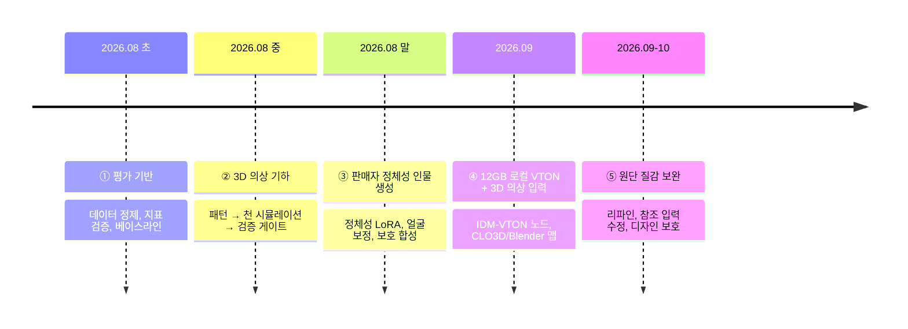
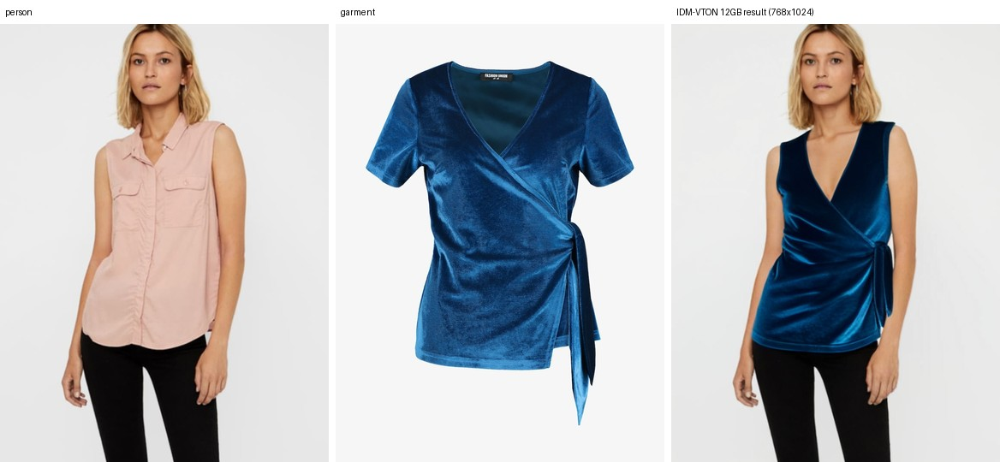
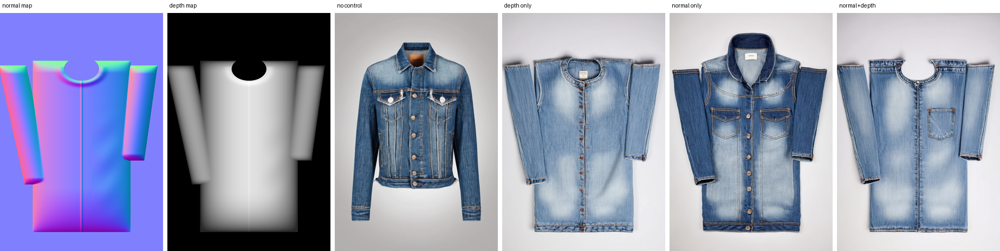

# Fashion VTON Research

**1인 브랜드 의류 쇼핑몰의 상품 착용 이미지를 촬영 없이 만들기 위한 가상 피팅(VTON) 연구: 평가 체계, 3D 의상 기하, 판매자 정체성 생성, 12GB 로컬 파이프라인, 원단 질감 보완**

| | |
|---|---|
| 기간 | 2026.08 ~ 2026.10 (진행 중) |
| 결과물 | 12GB GPU용 IDM-VTON ComfyUI 노드, 판매자 정체성 인물 생성 → FASHN 착장 → 보호 합성 파이프라인, 3D 의상 기하 검증 도구, 원단 질감 리파인 + 디자인 보호 |
| 핵심 기술 | IDM-VTON, FASHN VTON 1.5, SDXL LoRA, ControlNet, IP-Adapter, GroundingDINO/SAM, DensePose, GarmentCode, Blender |
| 환경 | 로컬 RTX 5070 12GB (학습만 L40S 46GB) |
| 테스트 | 단위 테스트 40개 + CLO3D 전처리 검사 18개 + Blender 맵 검사 22개, 모두 통과 |

> 협업 쇼핑몰의 상품 사진, 판매자 얼굴 데이터, 학습된 가중치, 이를 포함한 결과 이미지는 공개하지 않습니다. 아래 이미지는 IDM-VTON 공개 예제와 직접 만든 합성 데이터만 사용했습니다.

---

## 왜 시작했나

판매자 본인이 브랜드의 얼굴인 의류 쇼핑몰은 신상품마다 직접 착용 촬영을 해야 합니다. 목표는 **판매자의 얼굴과 체형은 유지하면서 새로운 포즈·배경의 인물을 생성하고, 실제 상품 누끼 이미지를 그 인물에 입혀** 상업용 상품 이미지를 만드는 것이었습니다.

조건이 까다로웠습니다.

- 상품의 색, 프린트, 넥라인, 단추, 소매 길이, 총장이 바뀌면 실패입니다. "그럴듯한 옷"이 아니라 "그 상품"이어야 합니다.
- 기존에 입고 있던 옷이 남으면 안 되고, 얼굴·손·배경은 건드리면 안 됩니다.
- **신상품에는 같은 포즈의 실제 착용 정답 사진이 없습니다.** 그래서 품질을 무엇으로 판단할지부터 정해야 했습니다.

## 연구 흐름



### ① 평가 기반: "무엇으로 판단할지부터"

협업 쇼핑몰의 상품 아카이브(756상품, 18,045장)를 상품 누끼·착용컷·원단 매크로·디테일로 역할을 나누고, 중복을 걸러내고, **상품 단위로 train/val을 분할**했습니다. 같은 상품의 여러 포즈를 독립 표본으로 세지 않기 위해서입니다.

| 실험 | 결과 | 판단 |
|---|---|---|
| 드레이프 지표를 실제 이미지에 통제된 변형을 가해 검증 | 7개 통과, meso energy 탈락 | 통과한 지표만 사용 |
| 12개 상품 FASHN 베이스라인 | 의류 마스크 IoU 중앙값 0.782, 하위 10% 0.674 | 동작하지만 형태 오류가 남음 |
| 해상도·여백 게이트 | 여백 15% + 864px에서 IoU +0.042, 더 크게 하면 오히려 악화 | 운영점 고정 |
| 질감 참조 리파이너 ablation | 참조 유무의 차이가 우연과 구별되지 않음 (p=0.82) | **해당 경로 중단** |
| 시드 선택 상한 실험 | 최악 사례 IoU 0.287 → 0.509 | 선택만으로는 심한 형태 오류를 못 고침 → 명시적 기하 필요 |

### ② 3D 의상 기하: "실행됐다와 맞았다를 구분하는 게이트"

옷의 형태를 확률적 생성에 맡기지 않고 3D로 고정할 수 있는지 시험했습니다. 치수 → 2D 패턴(GarmentCode) → 봉제 메시 → Blender 천 시뮬레이션 → 실루엣·depth·normal 렌더 경로를 만들었습니다.

- 패턴 치수 6개를 목표값 **0.10cm 이내**로 맞췄습니다.
- 시뮬레이션이 "멈춰 있어서 수렴한 것처럼 보이는" 거짓 성공을 잡기 위해, 중력 없는 대조군과 실제로 다르게 움직였는지 비교하는 게이트를 만들었습니다. 최종 실행은 대조군 대비 실루엣 IoU 0.903, 정점의 96.5%가 5mm 이상 이동해 통과했습니다.
- 외부 인체 메시의 내부/외부 판정이 삼각형 경계에서 뒤집히는 문제를 3방향 ray 투표로 고쳤습니다.
- 전체 오케스트레이터는 렌더한 마스크를 자기 자신의 정답으로 쓰면(IoU 1.0 거짓 주장) 기본적으로 거부합니다.

판단: 합성 데이터의 기계적 검증은 통과했지만, **실제 사람이 입은 정답 촬영 없이는 다음 증거를 만들 수 없습니다.** 실측 촬영 프로토콜을 준비해 두고 이 갈래는 대기 상태로 두었습니다. 상용 라이선스도 함께 검토해 비상업 포크와 SMPL-X는 제외했습니다 ([라이선스 판단](docs/third_party_decision.md)).

### ③ 판매자 정체성 인물 생성: "캡션이 통제권을 결정한다"

기존 사진의 옷만 바꾸는 대신, **판매자 정체성 LoRA로 새 인물을 처음부터 생성 → 상품을 FASHN으로 입힘 → 얼굴·손·배경 픽셀을 보호 합성**하는 구조로 정했습니다.

정체성은 얼굴 임베딩(SFace) 코사인으로 쟀습니다. 기준선은 실제 판매자 사진끼리의 유사도 중앙값 0.499입니다.

| 구성 | 정체성 | 기준선 대비 |
|---|---:|---:|
| LoRA 없음 | 0.108 | 22% |
| v1: 40장 모두 같은 한 줄 캡션 | 0.289 | 46% |
| v2: 이미지별 캡션 37종 + 얼굴 크롭 | **0.467** | **94%** |

- v1의 실패 원인은 캡션이었습니다. 옷·배경·포즈가 전부 트리거 토큰에 흡수됐고, "전신 사진"이라는 캡션이 반신 사진에 대해 거짓이었습니다.
- v3에서는 캡션만 바꾼 통제 실험으로 **안경을 프롬프트로 켜고 끌 수 있게** 됐습니다. 목걸이는 실패했는데, 실제 15장 중 5장에만 캡션을 달았기 때문이었습니다. 결론: **캡션은 해당 이미지 100%에 달렸을 때만 통제권이 된다.** 이 개선은 학습 loss에는 전혀 나타나지 않았습니다(소수점 넷째 자리 차이).
- 전신 컷에서는 얼굴이 작아 정체성이 46%로 떨어졌습니다. 얼굴만 다시 그리는 보정을 VTON **전에** 적용해 80%로 올렸고, 캔버스를 2배로 키워 84%까지 올렸습니다.
- **합성 버그 수정**: 옷 경계 안쪽으로 블렌딩하면 좁은 띠에서 원래 옷이나 맨살이 다시 섞였습니다. 블렌딩을 경계 바깥으로 옮기고, 얼굴·머리 영역은 마지막에 무조건 원본으로 되돌리게 해 보호 영역 변화 **0픽셀(byte-identical)**을 확인했습니다.
- 포즈는 프롬프트만으로는 3번 중 1번 지켜졌고, ControlNet으로 고정하자 3/3이었습니다.

학습이 끝난 뒤 서버에서 판매자 얼굴 데이터를 포함한 작업 파일을 모두 삭제했습니다. 이후 학습을 제외한 전 공정은 로컬 12GB에서 돌아갑니다.

### ④ 12GB 로컬 VTON + 3D 의상 입력

IDM-VTON을 RTX 5070 12GB에서 돌리는 ComfyUI 노드를 만들었습니다 ([노드 문서](comfyui_vton/ComfyUI-IDM-VTON-12GB/USAGE_ko.md)).


<sub>IDM-VTON 공개 예제 인물·의상으로 실행한 결과</sub>

- 전처리(GroundingDINO → SAM → DensePose)와 추론을 별도 프로세스로 나눠, 끝나면 모델 메모리를 반환합니다.
- FP16 + 순차 CPU 오프로딩. upstream이 컴포넌트로 등록하지 않은 `unet_encoder`까지 따로 오프로딩해야 메모리가 줄어드는 것을 찾았습니다.
- 768×1024, 20 steps: 추론 43초, PyTorch 최대 예약 메모리 약 2.2GB (프로세스 기준)
- 공용 ComfyUI 환경을 건드리지 않도록 구버전 라이브러리를 분리 환경에 두고 CUDA PyTorch만 공유했습니다.

3D 의상에서 상품 이미지를 만드는 경로도 만들었습니다: 의상 OBJ → Blender에서 depth/normal 렌더 → SDXL ControlNet.


<sub>합성 의상 맵으로 조건 없음 / depth / normal / 둘 다를 비교한 결과</sub>

- normal map의 축 규약을 전처리기 출력으로 실측했습니다(R=-x, G=+y, B=+z).
- 실제 GarmentCode 시뮬레이션 메시를 넣자 실행은 성공했지만 결과 품질은 나빴습니다. **실행 성공과 품질 성공을 분리해서** 기록했습니다.

### ⑤ 원단 질감 보완: "질감이 생겼다 ≠ 그 원단이다"

형태는 나아졌지만 데님이 매끈한 샴브레이처럼, 니트가 평평하게 나왔습니다.

| 시도 | 결과 |
|---|---|
| IDM steps·CFG·해상도·프롬프트 5가지 변형 | 상품에 맞는 질감 개선 없음 → 기본값 유지 |
| FASHN과 같은 프레임 비교 | 데님 색은 FASHN, 니트 선명도는 IDM이 나은 사례 → 엔진 교체로 해결되지 않음 |
| SDXL tile 리파인 + IP-Adapter 원단 참조 | 데님·알파카 일부에서 재질감 개선, 대신 색이 끌리는 문제 |
| **참조 입력 버그 수정** | 원단 조각 2장을 가로 콜라주로 넣으면 CLIP의 중앙 정사각 크롭이 양쪽 절반을 잘라냄 → 조각별 개별 인코딩으로 변경 |
| **디자인 보호 + 건너뛰기 정책** | 단추·지퍼·로고·봉제선·패턴 경계를 보호 마스크로 잡고, 보호 비율이 35%를 넘으면 리파인 자체를 건너뜀. 개발 사례 9개 중 5개 리파인, 4개(니트·체크·줄무늬·링거티) 건너뜀 |

케이블 니트의 구조 소실은 해결하지 못했고, 현재 정책은 구조가 많은 옷의 리파인을 건너뛰는 것입니다. 다음 단계로 신규 6상품 × 인물 2명 × 시드 3개, 5개 조건(원본 / 색 보정 / 리파인 / + 누끼 참조 / + 클로즈업 참조) 비교를 설계해 두었습니다 (아직 실행 전).

## 실패에서 얻은 원칙

| 실패 | 바꾼 원칙 |
|---|---|
| 자동 게이트가 전부 통과했는데 목걸이가 끊어져 남는 결함이 있었음 (게이트가 놓친 네 번째 사례) | 자동 게이트 단독으로 Go/No-Go 하지 않고 확대 육안 검수를 병행 |
| 2배 해상도 결과를 1배로 줄여 비교해 "2배가 더 무르다"고 잘못 측정 | 해상도 비교는 실제 배송 해상도에서 |
| "FASHN 내부 해상도가 상한이라 베이스만 키우면 옷은 무를 것"이라는 예측 | 실험으로 반증됨(옷 조직감 2.21배). 예측은 측정으로 확인 |
| "단추 2개 → 1개"를 구조적 한계로 단정 | 배경 3개에서 1/2/2로 흔들림. 단일 관측으로 결론 내리지 않음 |
| 학습 loss로 LoRA 개선 여부를 판단하려 함 | loss는 통제권 개선을 보여주지 못함. 생성 → 지표 → 확대 육안으로 판정 |
| 민소매 인물에 긴소매를 입히자 소매가 짧게 생성 | 모델 한계가 아니라 마스크 문제. 현재 옷 영역과 새 옷이 필요한 영역은 다름 |
| GarmentCode 메시로 실행은 성공했지만 결과가 나쁨 | 실행 성공과 품질 성공을 따로 기록 |

## 한계

- 실제 착용 정답이 없어서 대부분의 비교가 소수 상품, 시드 1개, 육안 판정입니다. 재질감 개선 사례는 있지만 정확한 원단 복원, 새 상품으로의 일반화, 상용 품질은 입증하지 않았습니다.
- 디자인 보호는 VTON이 이미 만든 디자인을 지키는 장치입니다. VTON 단계에서 틀린 단추나 케이블을 되돌리지는 못합니다. 임계값도 개발 사례 9개로 수동 조정했습니다.
- 3D 기하 갈래는 합성 데이터 검증까지만 했고, 실제 착용 촬영과의 비교가 남아 있습니다.
- IDM-VTON 원본 모델은 비상업 라이선스(CC BY-NC-SA 4.0)입니다.

## 저장소 구조

```
product_pipeline/          ①②③ 단계 (서로 import하는 스크립트라 한 폴더에 둠)
  catalog_eval.py          평가 세트 구성, FASHN 실행, 보호 하드 합성
  drape_metrics.py         드레이프 지표 + validate_drape_metrics.py
  resolution_gate.py, seed_selector_gate.py, residual_garment_gate.py
  garmentcode_*.py         치수 → 패턴 → 봉제 메시 계약
  blender_cloth_sim.py     천 시뮬레이션, blender_geometry_render.py 조건 맵 렌더
  run_real_gc1.py          실측 파일럿 오케스트레이터 (재개 가능, 자기평가 거부)
  gen_person_base.py       정체성 인물 생성, train_identity_lora.py 12GB용 LoRA 학습기
  face_detailer.py, identity_score.py, composite_erase_fix.py
  test_*.py                단위 테스트 40개
comfyui_vton/              ④⑤ 단계
  ComfyUI-IDM-VTON-12GB/   ComfyUI 노드 (config.example.json → config.json으로 복사해 사용)
  blender_render_maps.py, prepare_clo3d_maps.py, build_clo3d_workflow.py
  refine_texture.py        색 보정 + SDXL tile 리파인 + IP-Adapter 참조
  design_protect.py        디자인 보호 마스크와 건너뛰기 정책
  graphic_transplant.py    깨진 문자를 원본 누끼에서 이식 (제한된 실험)
  test_clo3d_prep.py, test_blender_maps.py
docs/
  experiments.md           단계별 상세 기록과 수치
  geometry_pilot.md        실측 파일럿 촬영·판정 프로토콜
  cloth_ablation.md        천 프리셋 ablation
  third_party_decision.md  상용 라이선스 판단
```

## 역할

평가 지표 설계·검증, 3D 의상 기하 파이프라인, 정체성 LoRA 학습과 합성 파이프라인, 12GB ComfyUI 노드, 질감 리파인과 디자인 보호까지 전 과정을 수행했습니다. 구현에는 AI 코딩 도구를 적극 활용했고, 실험 설계·판단 기준·결과 해석은 직접 수립했습니다.
