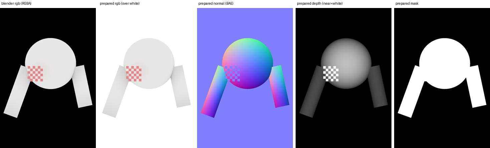

# 실험 기록

README의 연구 흐름 ①~⑤ 순서입니다. 수치마다 어떤 조건에서 나온 값인지 밝혔습니다. 대부분의 비교는 소수 상품·소수 시드라서, 일반화된 성능이 아니라 **그 조건에서 관찰한 값**으로 읽어야 합니다.

---

## ① 평가 기반 (2026.08)

### 데이터

| 항목 | 값 |
|---|---:|
| 상품 | 756 |
| 이미지 | 18,045 |
| 상품 누끼 (garment_flat) | 1,085 |
| 착용컷 (worn) | 13,841 |
| 원단 매크로 | 119 |
| 구조 디테일 | 1,215 |
| 선택된 누끼-착용 pair | 1,950 |

- 자동 역할 분류는 틀릴 수 있어(앞/뒷면, 여러 색상, 매크로 위 문자) 실험에 쓰는 이미지는 직접 검수했습니다.
- 같은 상품의 누끼-착용 pair라도 카메라·포즈·조명이 다릅니다. **픽셀 정렬된 정답이 아니므로** PSNR 같은 비교를 하지 않았습니다.
- 평가 세트: 25개 독립 상품 × 4포즈 = 100개 관측. 통계적 독립 단위는 25개 상품이고 4포즈는 반복 측정입니다. 같은 포즈의 교차 착용 정답이 없어 프로토콜을 `self_reconstruction_proxy`로 명시했습니다.

### 드레이프 지표 검증

주름 밀도·강도·방향 엔트로피, 드레이프 공간주파수 대역, 밑단 곡률·처짐, 실루엣 플레어 등을 정의하고, 실제 이미지에 통제된 변형을 가해 각 지표가 의도한 변화에 반응하는지 확인했습니다. 7개가 통과했고 meso energy는 탈락해 사용하지 않았습니다. 코덱·리사이즈·마스크 지터로 생기는 측정 잡음 바닥과 같은 상품의 포즈 변동을 분리해서, 모델 오차가 잡음보다 큰지 판단할 수 있게 했습니다.

### 게이트 실험

| 게이트 | 결과 | 결정 |
|---|---|---|
| 12개 상품 FASHN 베이스라인 | 의류 마스크 IoU 중앙값 0.7822, P10 0.6736 | 동작하지만 상업적 형태 오류 남음 |
| 해상도·여백 | 여백 15% + 864px에서 paired IoU +0.0418. 1008px, 여백 30%는 악화 | `m15_g864` 고정 |
| 생성 인물 | 가상의 SDXL 인물에 FASHN 적용 시 옷 바깥 영역 완전 보존 | 생성 인물 경로 기술적으로 가능, 소매 후광은 남음 |
| 질감 참조 ablation | 참조 기여가 우연과 구별되지 않음 (p=0.82) | 참조 리파이너 경로 중단 |
| 시드 선택 상한 | 최악 사례 IoU 0.2869 → 0.5094 (+0.2225) | 선택에는 여지가 있지만 심한 구조 오류는 못 고침 |
| 같은 사례의 엄격한 기하 진단 | Boundary F1 0.3538, 대칭 경계 오차가 옷 높이의 6.65% | 명시적 기하가 다음 핵심 과제 |

---

## ② 3D 의상 기하 (2026.08)

### 패턴과 메시

- GarmentCode(MIT, 커밋 고정)로 몸판·소매 패턴을 만들고, 실제 생성된 패턴을 다시 재서 보정하는 반복으로 6개 치수를 맞췄습니다: 어깨 +0.039cm, 가슴 -0.100cm, 총장 +0.098cm, 소매 0, 커프 +0.003cm, 밑단 0.
- 봉제 메시 계약: 8패널, 16 stitch.

### 실패와 진단

1. 느슨한 봉제 스프링이 멀리서 패널을 당겨 형태가 왜곡됨 → 이음선 정점을 용접한 manifold 메시로 변경
2. Blender가 이미 감싼 3D 메시를 "힘이 없는 원래 모양"으로 취급 → 중력 결과가 평평한 형태로 수렴. 힘 없는 대조군이 0.01mm 미만 움직였는데 충돌만으로 39.32mm 이동해서 발견
3. 진짜 원인은 원단 강성이 아니었습니다: 베지어 곡선을 같은 파라미터 간격으로 샘플링해 겨드랑이 구간 길이가 최대 20% 어긋났고, 정점별 충돌 투영이 1.5배 이상 늘어난 변을 3개에서 437개로 늘렸고, 겹친 인체 부품들이 서로 다른 충돌 제약을 걸었습니다.
4. 해결: 호 길이 샘플링, 얇은 삼각형 제거, 인체를 하나의 watertight 메시로 Boolean 합치기, 충돌을 고려한 사전 드레이프(P99 늘어남 1.449 → 1.088배, 1.5배 초과 변 148 → 1~2개)

### 검증 게이트

| 게이트 | 결과 |
|---|---|
| 중력 없는 대조군 | 121프레임에서 수렴, 평균 표류 0.585mm |
| 중력 실행 | 151프레임에서 수렴, 평균 0.893mm, 1.5배 초과 변 2개 |
| 대조군 vs 중력 | 실루엣 IoU 0.903, 평균 정점 차이 19.2mm, 정점 96.5%가 5mm 이상 이동 → 정적 형태 거짓 양성 배제 |
| 외부 인체 메시 경로 | 단일 ray 판정이 삼각형 경계에서 뒤집힘 → 3방향 다수결로 수정, 같은 게이트 통과 (IoU 0.866) |
| 오케스트레이터 스모크 | 10단계 완주. 렌더 마스크를 자기 정답으로 쓰면 기본 거부 |
| 인체 사전 검사 | 열린 메시는 시뮬레이션 전에 거부 (경계 변 4개 → 종료 코드 2) |

천 프리셋 ablation은 [cloth_ablation.md](cloth_ablation.md)에 있습니다. 질량과 여러 강성 축을 함께 바꿨기 때문에 "조절할 수 있다"는 증거일 뿐, 실제 원단 파라미터를 식별한 것은 아닙니다.

### 남은 증거

합성 데이터의 기계적 검증까지는 통과했지만, 실제 사람의 핏은 검증하지 않았습니다. 같은 사람·포즈·카메라·조명으로 찍은 실측 착용 사진, 인체 메시, 옷 치수가 필요합니다. 판정 기준은 IoU 0.80 이상, 랜드마크 오차 중앙값이 옷 높이의 5% 이하입니다 ([geometry_pilot.md](geometry_pilot.md)).

---

## ③ 판매자 정체성 인물 생성 (2026.08)

### 데이터 제약

정체성 후보 1,185장 중 얼굴이 200px 이상인 사진은 39장, 250px 이상은 12장뿐이었고 대부분 정면이 아니었습니다. 선별한 50장을 상품 단위로 40/10 분할했습니다(같은 촬영에서 나온 사진이 양쪽에 들어가지 않게).

### 정체성 LoRA

평가: OpenCV YuNet + SFace 128차원 임베딩 코사인. 실제 판매자 홀드아웃 사진끼리의 중앙값 0.499(범위 0.21~0.72)를 기준선으로 씁니다.

| 구성 | 홀드아웃 코사인 | 기준선 대비 |
|---|---:|---:|
| LoRA 없음 | 0.108 | 22% |
| v1 (동일 캡션 40장, 몸 크롭만) | 0.289 | 46% |
| v2 (캡션 37종 + 얼굴 크롭 40장) | 0.467 | 94% |

육안 판단이 수치로 뒤집힌 사례가 3건 있었습니다: "얼굴 크롭은 업샘플이 커서 못 쓴다"(1024 버킷 기준이라 틀림, 512 버킷이면 1.47배), "v1은 아무것도 못 배웠다"(실제로는 격차의 46%를 좁힘), "원인은 프롬프트"(주원인은 캡션).

### 출력 프레이밍

| 프레이밍 | 얼굴 크기 | 코사인 |
|---|---:|---:|
| 전신 + ControlNet | 약 90px | 0.272 |
| 전신, ControlNet 없음 | 약 90px | 0.209 |
| 반신 | 약 150px | 0.341 |
| 상반신 | 약 250px | 0.467 |

ControlNet은 원인이 아니었습니다(꺼도 더 낮음). 입력 데이터의 얼굴 해상도 제약이 출력에서도 재현된 것입니다.

### 얼굴 보정

얼굴 검출 → 2.2배 여백 크롭 → 1024로 img2img 재생성(정체성 LoRA 적용) → 경계를 부드럽게 되붙임. VTON **전에** 적용해서, 이후 보호 합성이 그대로 지켜 줍니다.

| denoise | 없음 | 0.35 | 0.5 | 0.65 | 0.8 |
|---|---:|---:|---:|---:|---:|
| 3장 평균 | 0.229 | 0.312 | **0.401** | 0.376 | 0.389 |

0.5를 채택했지만 0.5/0.65/0.8 차이는 이미지 3장·시드 1개라 유의하지 않습니다. 확실한 것은 "보정하면 크게 오른다"와 "0.35는 부족하다" 두 가지입니다.

### 고해상도 캔버스

| | 1배 | 2배 |
|---|---:|---:|
| 출력 | 832×1216 | 1664×2432 |
| 검출 얼굴 높이 | 106px | 218px |
| 전신 정체성 | 0.401 (80%) | 0.417 (84%) |
| 옷 조직감 (배송 해상도, 같은 물리 영역) | 기준 | 2.21배 |

"FASHN 내부 해상도가 상한이라 베이스만 키우면 얼굴만 선명하고 옷은 무를 것"이라는 예측이 반증됐습니다. 2배 베이스에서는 상반신 크롭 자체가 픽셀상 2배라 옷이 FASHN 작업 해상도에서 차지하는 몫이 커집니다. 중간에 "2배가 9% 더 무르다"고 했던 측정은 2배 결과를 1배로 줄여서 잰 실수였습니다.

### 합성

- 옷 경계 **안쪽** feather는 좁은 띠에서 알파가 1에 도달하지 못해 원래 옷(감산 영역)이나 맨살(가산 영역)이 섞였습니다. 경계 안쪽에서는 베이스가 항상 교체 대상을 들고 있으므로 안쪽 feather는 언제나 틀립니다. 블렌딩을 경계 **바깥**으로 옮겼습니다.
- 2배 캔버스에서 의류 영역이 얼굴·머리·안경 28px를 침범한 것을 발견해, 마지막 단계에서 보호 라벨을 무조건 원본으로 되돌리게 했습니다. 보호 영역 423,248px 변경 0, 의류 영역 밖 변경 0.
- 중립 이너를 민소매로 바꾸자 "기존 옷 ∖ 새 옷" 영역이 3,885 → 519px(-87%)로 줄었습니다. 새 옷이 더 덮는 쪽으로 바뀌면 기존 옷이 남는 일이 원리적으로 없어집니다.
- VTON 전후 실제 얼굴 영역 변경 0px. 정체성 점수 0.4286 → 0.4337의 차이는 검출 정렬 흔들림입니다.

### 3 배경 × 3 상품 매트릭스

9칸 모두 자동 지표를 통과했고, 최종 정체성은 상품이 아니라 배경에 따라서만 달라졌습니다(파이프라인이 맞다는 신호). 하지만:

- 목걸이 체인이 목 위에 끊어진 조각으로 남는 결함이 있었습니다. LoRA가 판매자 사진의 목걸이를 재현 → FASHN이 카라를 그리며 지움 → 합성이 옷 영역 밖에서만 베이스를 복원. **자동 게이트가 실제 결함을 놓친 네 번째 사례**입니다. 상품컷에 상품 아닌 액세서리가 있을 이유가 없으므로 생성 단계 negative로 막았습니다.
- 여밈 검증을 하려고 상품을 넓혔는데 고른 3벌 중 여밈이 있는 옷은 1벌뿐이었습니다. 검증하려는 축이 실제로 넓어졌는지 확인해야 한다는 설계 교훈입니다.
- 단추 개수 오류는 배경에 따라 1/2/2로 흔들렸습니다. 단일 관측으로 "구조적 한계"라고 했던 판단을 취소했습니다.

### 캡션 커버리지 (v2 vs v3)

v2와 v3는 캡션 텍스트만 다른 통제 실험입니다(이미지 80장, rank 32, batch 4, LR 1e-4, 1,500 step, 같은 seed).

| | v2 | v3 |
|---|---:|---:|
| 전신 정체성 | 0.417 (84%) | 0.412 (83%) |
| 안경 | 무작위 | 프롬프트로 제어 가능 |
| 목걸이 | 3/3 잔존 | 3/3 잔존 |

안경은 해당 27장 전부에 캡션을 달았고, 목걸이는 실제 15장 중 5장(33%)만 달았습니다. 두 실행의 loss 평균은 0.1312와 0.1311로 개선이 전혀 드러나지 않았습니다.

---

## ④ 12GB 로컬 VTON + 3D 의상 입력 (2026.09)

### IDM-VTON 12GB 노드

| 단계 | 결과 |
|---|---|
| 384×512, 4 steps (runner 단독) | 추론 11.5초, 최대 예약 VRAM 1.2GB |
| 768×1024, 20 steps (runner 단독) | 추론 43초, 모델 로딩 포함 60초, 최대 예약 VRAM 2.2GB |
| 768×1024, 20 steps (ComfyUI 전체) | 전처리 → 추론 → 저장 약 82초 |

VRAM 수치는 한 프로세스의 PyTorch 통계입니다. CPU 오프로딩 때문에 실제 병목은 시스템 RAM(32GB 환경)과 PCIe 전송입니다.

마스크 교훈: 민소매 인물에 긴소매를 입히면 기존 옷 영역만 지워서는 소매 공간이 없어 소매가 짧게 생성됩니다. 현재 옷 영역과 새 옷이 필요한 영역은 다르므로 팔 영역을 포함하되 손·얼굴은 보호해야 합니다.

### 3D 의상 → ControlNet



- 의상 OBJ/FBX → Blender 4.5 → RGB/normal/depth/mask 렌더 → 정합 유지 전처리 → RealVisXL + ControlNet Union(normal 0.6, depth 0.75).
- 리뷰를 거쳐 반영: float depth 입력, 크기 불일치 거부, 알파 기반 마스크, 재질 opacity 보존, EXR Z 채널 오독 제거.
- normal 규약은 실측(R=-x, G=+y, B=+z). Blender raw normal은 R이 오른쪽이라 x를 뒤집어야 합니다.
- GarmentCode 시뮬레이션 메시로 실행은 성공(약 22.9초)했지만 심한 주름과 낮은 의상 점유율 때문에 결과가 나빴습니다. 실제 CLO3D 원본 파일이 확보되면 재개할 보조 경로로 남겼습니다.

---

## ⑤ 원단 질감 보완 (2026.09 ~ 10)

### IDM 자체 튜닝

20 steps/CFG 2 기준 대비 40 steps/CFG 2, 40/CFG 3, 상품 타이트 크롭, 고해상도 재추론, 원단 프롬프트 변형을 비교했습니다. 상품에 맞는 질감 개선을 확인하지 못해 기본값을 바꾸지 않았습니다. 인위적인 grain이나 샤프닝으로 개선을 가장하지 않았습니다.

### 리파인 파이프라인

```
VTON 출력 → 출력에 다시 GroundingDINO/SAM 옷 마스크
→ 상품 누끼 기준 Lab 색 보정 → 디자인 보호 / 건너뛰기 판정
→ 옷 영역 2배 확대 → tile ControlNet + SDXL img2img (+ 같은 상품 IP-Adapter 참조)
→ 마스크 합성
```

### 참조 입력 수정

| 문제 | 수정 |
|---|---|
| 정사각 조각 2장을 1024×512 콜라주로 넣으면 CLIP 중앙 크롭이 양쪽 바깥 절반을 잘라냄 | 조각별 개별 인코딩 후 결합 |
| 2×2 콜라주는 224px 입력에서 조각당 정보가 너무 작음 | 같은 방식으로 해결 |

수정 후에도 니트 케이블은 계속 사라졌고, 알파카는 털 표현이 뚜렷해졌지만 색이 붉게 끌렸습니다(상품 1개, 시드 1개 근거).

### 디자인 보호

- GroundingDINO/SAM으로 `button · snap · zipper`, `logo · graphic print` 검출 (옷 면적 대비 너무 큰 덩어리는 오검출로 제거)
- 국소 색차가 큰 작고 둥근 덩어리로 단추 보조 검출
- Lab DoG 크기로 봉제선·포켓 테두리·케이블·패턴 경계 보호
- 보호 비율이 0.35를 넘으면 리파인을 건너뜀

| 사례 | 보호 비율 | 결과 |
|---|---:|---|
| 체크 | 0.88 | 건너뜀 |
| 줄무늬 | 0.85 | 건너뜀 |
| 니트 | 0.51 | 건너뜀 |
| 링거 티 | 0.37 | 건너뜀 (경계값 근처) |
| 나머지 5개 | 0.35 이하 | 리파인 |

리파인한 5건의 보호 영역 픽셀 변화는 평균 0.46~2.21, p99 5~13.3 (0~255 RGB). 한계: VTON이 이미 만든 디자인을 지킬 뿐 틀린 디자인을 되돌리지 못하고, 후단 색 보정 전에 계산하며, 임계값은 개발 사례 9개로 수동 조정했습니다.

### 다음 실험 설계 (실행 전)

신규 6상품(데님 2, 플리스/헤어리 2, 케이블 1, 체크/줄무늬 1) × 고정 인물 2명 × 시드 3개.

| 조건 | 처리 |
|---|---|
| A | VTON 원본 |
| B | 색 보정만 |
| C | B + 보호 정책 리파인, 참조 없음 |
| D | C + 상품 누끼 참조 |
| E | C + 같은 상품 클로즈업 참조 |

개발 사례에서 설정을 고정하고 신규 상품에서는 다시 튜닝하지 않습니다. 건너뛴 결과도 정책의 결과로 기록하고, 방법 이름을 가린 같은 크기 이미지와 같은 위치 확대로 원단 유사도 / 디자인 유지 / 얼굴·손 / 자연스러움을 따로 평가합니다. 자연스러움이 높아도 디자인 오류가 있으면 탈락입니다.
